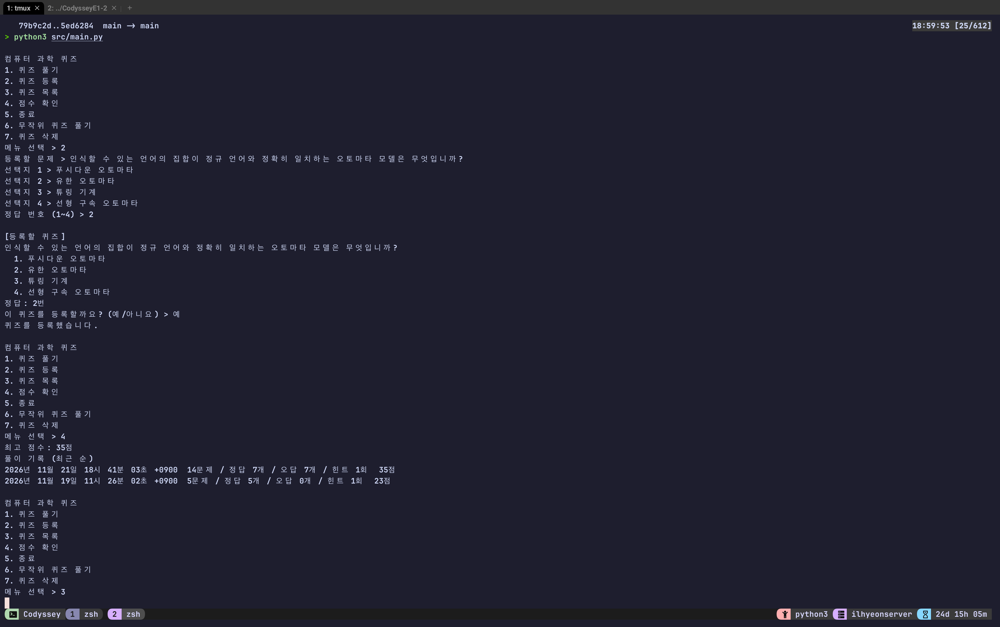
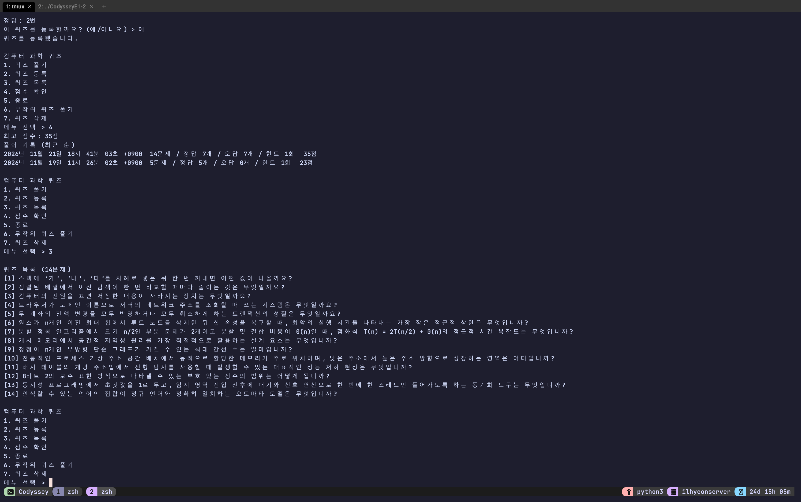
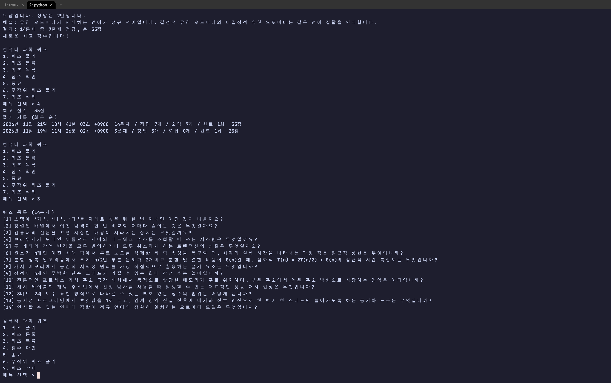
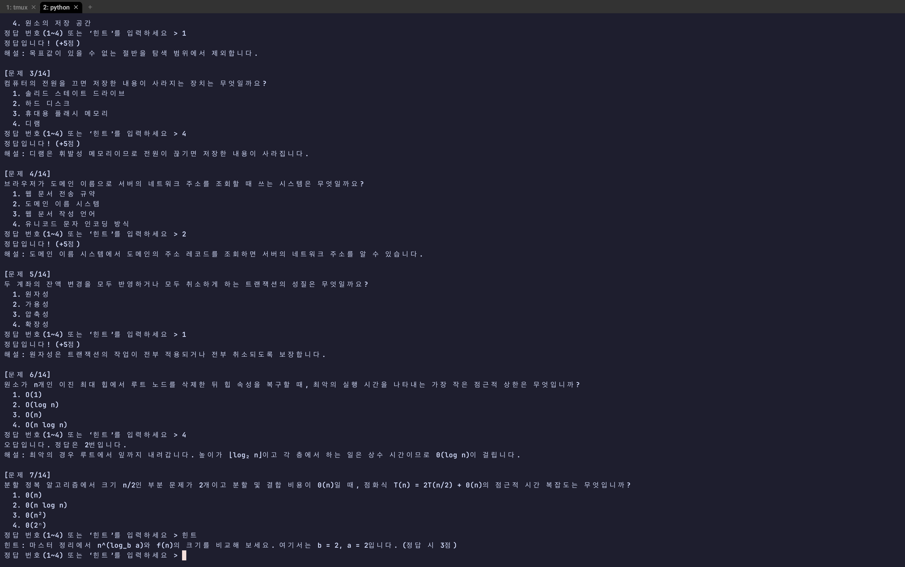
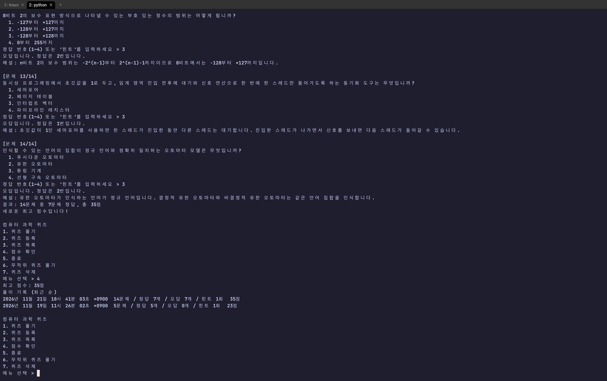
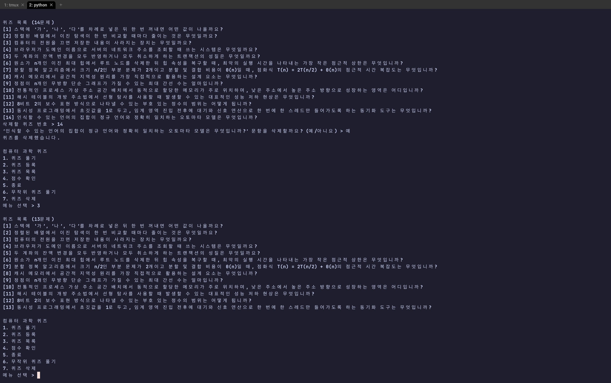
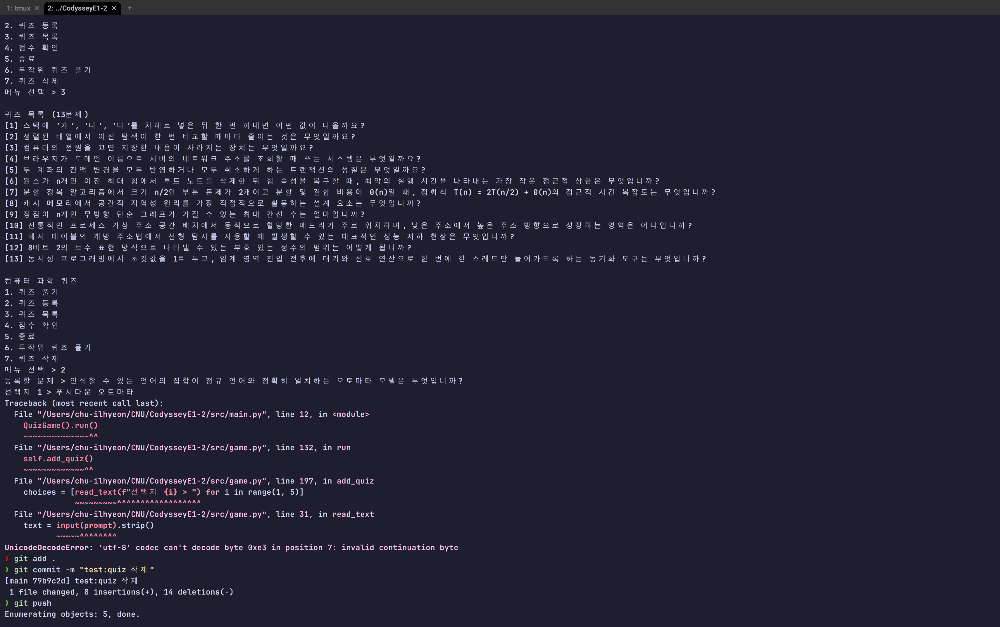
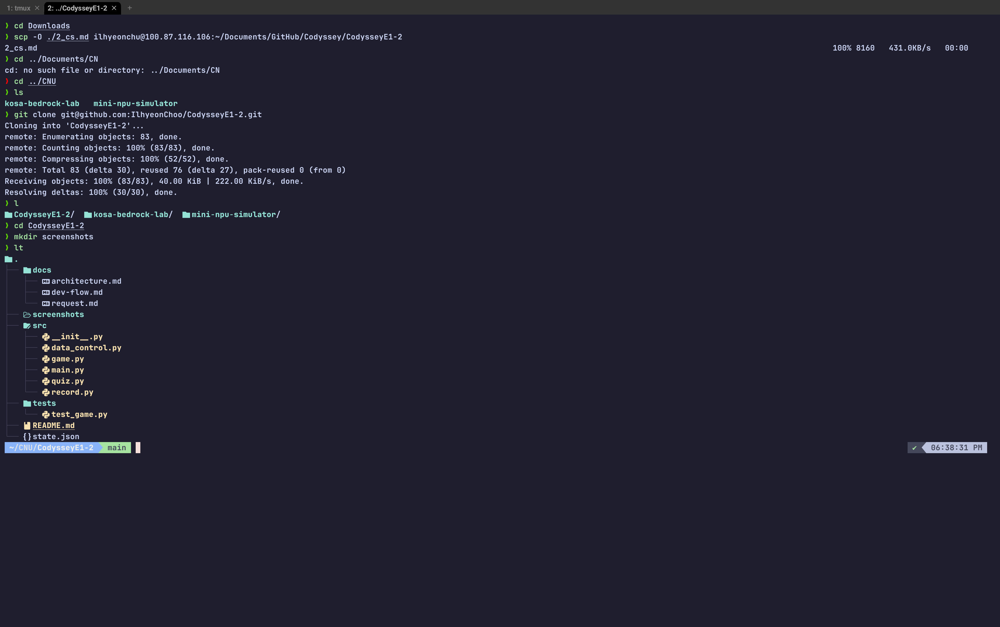
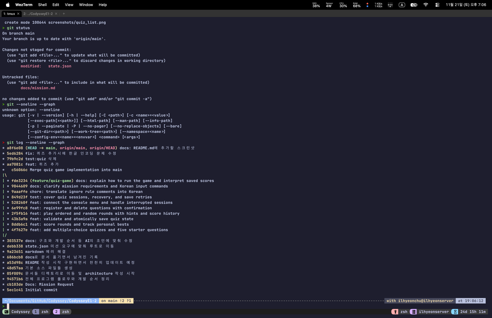

# 컴퓨터 과학 퀴즈 게임

터미널에서 컴퓨터 과학 객관식 퀴즈를 풀고 새 문항을 등록하는 파이썬 프로그램입니다. 기본 14문항은 자료구조와 알고리즘, 컴퓨터 구조, 운영체제, 네트워크, 데이터베이스, 이산수학과 형식 언어를 다룹니다. 추가한 문항과 최고 점수, 풀이 기록은 게임을 종료한 뒤에도 유지됩니다.

## 주제 선정 이유

코디세이에서 인공지능을 활용해 소프트웨어를 개발할 때, 컴퓨터 과학의 기초를 알고 있으면 더 효율적으로 문제를 풀 수 있다고 생각했습니다. 그래서 소프트웨어 개발에 필요한 기초 개념을 퀴즈 주제로 골랐습니다.

## 실행 방법

Python 3.10 이상이 필요하며 표준 라이브러리만 사용합니다. 저장소를 내려받고 `README.md`가 있는 디렉터리에서 실행하세요.

```bash
python3 src/main.py
```

`uv`를 사용하는 경우 다음 명령으로 Python 3.11에서 실행할 수 있습니다.

```bash
uv run --no-project --python 3.11 python -m src.main
```

회귀 테스트는 `python3 -m unittest discover -s tests -v`로 실행합니다. 테스트 데이터는 임시 디렉터리에 저장합니다.

## 기능 목록

| 번호 | 기능 | 사용 방법 |
| --- | --- | --- |
| 1 | 퀴즈 풀기 | 등록된 순서대로 모든 문항을 풉니다. 정답 번호는 1~4이고, `힌트`를 입력하면 힌트를 봅니다. |
| 2 | 퀴즈 등록 | 문제, 선택지 4개, 정답 번호를 입력합니다. 미리보기를 확인하고 `예`를 입력하면 저장하고, `아니요`를 입력하면 취소합니다. |
| 3 | 퀴즈 목록 | 등록된 순서대로 번호와 문제를 확인합니다. |
| 4 | 점수 확인 | 최고 점수와 완료한 라운드의 기록을 최근 순서로 확인합니다. |
| 5 | 종료 | 저장을 마치고 게임을 종료합니다. |
| 6 | 무작위 퀴즈 풀기 | 풀 문항 수를 선택하면 중복 없이 무작위로 출제합니다. |
| 7 | 퀴즈 삭제 | 목록 번호로 문항을 선택하고 `예`로 확인하면 삭제합니다. |

정답은 5점, 힌트를 보고 맞히면 3점, 오답은 0점입니다. 예를 들어 세 문항 중 한 문항을 바로 맞히고 한 문항을 힌트로 맞히면 총 8점입니다. 최고 점수는 끝까지 푼 한 판의 총점으로 비교하며, 동점이면 먼저 달성한 기록을 유지합니다.

빈 입력이나 범위 밖의 번호를 입력하면 같은 항목을 다시 묻습니다. 읽을 수 없는 문자가 섞인 경우에도 해당 줄만 다시 입력하면 됩니다. 예를 들어 두 번째 선택지에서 오류가 나면 문제와 첫 번째 선택지는 그대로 유지됩니다. `Ctrl+C`를 누르거나 입력이 끝나면 게임을 종료합니다. 이때 확인 전인 문항이나 풀이 중인 판은 기록에서 제외됩니다.

## 파일 구조

```text
.
├── README.md
├── state.json           퀴즈, 최고 점수, 풀이 기록
├── docs/                미션 요구사항, 프로그램 설계와 흐름
├── screenshots/         게임 실행과 Git 실습 화면
├── src/
│   ├── __init__.py
│   ├── main.py          게임을 시작하는 진입점
│   ├── game.py          QuizGame 클래스와 메뉴, 입력, 라운드 진행
│   ├── quiz.py          Quiz 클래스와 복구에 쓰는 기본 문항
│   ├── record.py        문항별 채점과 완료한 라운드 기록
│   └── data_control.py  저장 파일 읽기, 형식 검증, 쓰기
└── tests/
    └── test_game.py     게임 진행과 저장 동작 테스트
```

## 데이터 파일 `state.json`

실행 디렉터리에 관계없이 저장소 루트의 `state.json`을 UTF-8로 읽고 씁니다.

| 필드 | 내용 |
| --- | --- |
| `quizzes` | 문항 목록입니다. 각 문항에는 문제 `question`, 선택지 4개 `choices`, 정답 번호 `answer`(1~4)가 필요합니다. 힌트 `hint`, 해설 `explanation`, 등록일 `created_at`은 선택 항목입니다. |
| `best_score` | 완료한 라운드의 최고 점수입니다. 첫 플레이 전에는 `null`, 한 판을 완료해 얻은 0점은 `0`입니다. |
| `records` | 완료 순서대로 플레이 시각 `played_at`, 문항 수 `question_count`, 총점 `score`를 저장합니다. 새 기록에는 정답 수 `correct_count`, 힌트를 본 문항 수 `hints_used`도 포함됩니다. |

한 문항만 담은 저장 형식 예시입니다. `answer`가 `3`이므로 세 번째 선택지인 ‘다’가 정답입니다.

```json
{
  "quizzes": [
    {
      "question": "스택에 ‘가’, ‘나’, ‘다’를 차례로 넣은 뒤 한 번 꺼내면 어떤 값이 나올까요?",
      "choices": ["가", "나", "다", "세 값이 한꺼번에 나온다"],
      "answer": 3
    }
  ],
  "best_score": null,
  "records": []
}
```

문항 등록·삭제를 확정하거나 한 판을 끝내면 즉시 저장합니다. 저장에 실패하면 변경 내용을 메모리에 두고 다음 저장 시점이나 종료 시 다시 시도합니다.

파일이 없거나 내용이 손상되면 기본 문항과 빈 점수 기록으로 시작합니다. 직접 모든 문항을 삭제해 저장한 빈 목록은 그대로 유지합니다. 읽기 권한 등의 문제로 파일을 열 수 없으면 원인을 안내하고 종료합니다.

## 미션 제출 자료

제출할 공개 저장소는 [IlhyeonChoo/CodysseyE1-2](https://github.com/IlhyeonChoo/CodysseyE1-2)입니다.

### 개발 환경

#### 개인 서버

OS : Ubuntu 24.04.5 LTS
Shell : Zsh
Terminal : WezTerm
Docker : 29.5.3
Docker Compose : 5.1.4
Git : 2.43.0
GitHub : 2.93.0
Other : <https://github.com/IlhyeonChoo/dotfiles.git>
        <https://github.com/IlhyeonChoo/nvim.git>

Mac 또는 Windows 에서 WezTerm 을 터미널로 사용
ssh를 이용해 접속
포트 포워딩 없이 Tailscale의 Tunneling을 이용

미션 제출용 개발 환경 캡처는 `screenshots/environment.png`에 추가할 예정입니다. 편집기와 Python 버전, Git 설정이 보이는 화면을 사용합니다.

### 프로그램 실행 화면

<details>
<summary>퀴즈 등록과 등록 결과</summary>

메뉴 2에서 정규 언어를 인식하는 오토마타에 관한 문제를 입력했습니다. 선택지 네 개와 정답 2번을 확인하고 `예`를 입력하자 등록 완료 메시지가 표시됐습니다.



메뉴 3을 열면 방금 등록한 문제가 목록의 14번에 보입니다.



</details>

<details>
<summary>퀴즈 목록</summary>

메뉴 3에서 스택 문제부터 오토마타 문제까지 14개 문항의 번호와 제목을 확인할 수 있습니다.



</details>

<details>
<summary>퀴즈 풀이와 힌트</summary>

6번 최대 힙 문제에서 오답을 입력하자 정답 번호와 해설이 표시됐습니다. 이어서 7번 분할 정복 문제에 `힌트`를 입력하자 마스터 정리에 관한 단서와 힌트 사용 시 배점이 나왔습니다.



</details>

<details>
<summary>라운드 결과와 점수 기록</summary>

14문항 중 7문항을 맞혀 35점으로 라운드를 마쳤습니다. 메뉴 4에서 최고 점수 35점과 이전 라운드의 23점 기록을 함께 확인했습니다.



</details>

<details>
<summary>퀴즈 삭제</summary>

메뉴 7에서 14번 오토마타 문항의 삭제를 확인한 뒤 목록을 다시 열었습니다. 문항 수가 14개에서 13개로 줄었습니다.



</details>

<details>
<summary>한글 선택지 입력 오류 · 수정 전 화면</summary>

첫 번째 선택지를 읽던 중 `UnicodeDecodeError`가 발생해 게임이 종료된 당시 화면입니다. 현재 버전에서는 읽을 수 없는 입력이 들어오면 오류를 안내하고 같은 선택지를 다시 묻습니다.



</details>

### Git 복제 실습과 이력

<details>
<summary>GitHub 저장소 복제</summary>

SSH로 저장소를 복제한 뒤 복제본에 들어가 `src/`, `docs/`, `tests/`와 루트의 `state.json`을 확인했습니다.



</details>

<details>
<summary>복제본의 변경을 원본에 반영하는 실습 명령</summary>

1. 원본 저장소의 `main`에 완성본을 푸시한 뒤, 원본 루트에서 아래 명령으로 별도의 실습 디렉터리를 만듭니다.

   ```bash
   git clone git@github.com:IlhyeonChoo/CodysseyE1-2.git ../CodysseyE1-2-practice
   cd ../CodysseyE1-2-practice
   python3 src/main.py
   ```

2. **복제본**에서 추가한 화면을 `screenshots/`에 저장합니다. 캡처 파일을 커밋해 푸시하고, `git log -1 --oneline`에 나오는 커밋 번호를 확인합니다.

   ```bash
   git add -- screenshots/
   git commit -m "docs: add environment and quiz screenshots"
   git push origin main
   git log -1 --oneline
   ```

3. **원본**으로 돌아와 변경을 받습니다. 복제본에서 본 커밋 번호와 원본의 커밋 번호가 같고, 추가한 사진이 들어왔는지 확인합니다.

   ```bash
   cd ../CodysseyE1-2
   git pull --ff-only origin main
   git log -1 --oneline
   ls screenshots/
   git log --oneline --graph
   ```

실습 로그도 첨부하려면 복제본의 푸시 결과, 원본의 풀 결과, 양쪽의 커밋 번호를 `docs/clone-pull.txt`에 저장합니다.

</details>

<details>
<summary>커밋 그래프와 기능 브랜치 병합</summary>

`git log --oneline --graph`에서 퀴즈 기능 브랜치 `feature/quiz-game`이 `main`에 병합된 커밋 `c56066c`를 확인할 수 있습니다.



</details>

[스크린샷 전체 보기](screenshots/)
